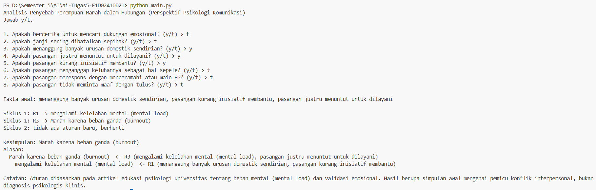
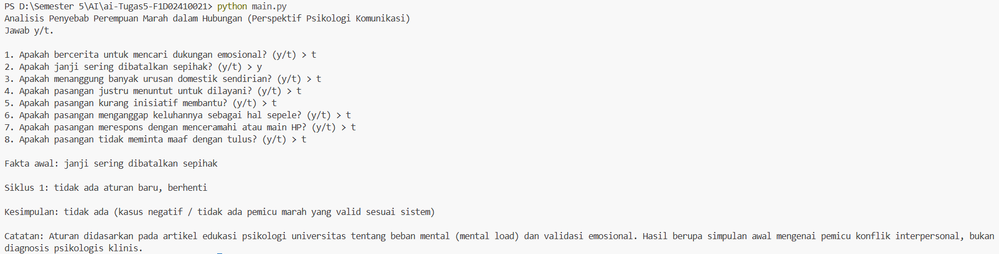
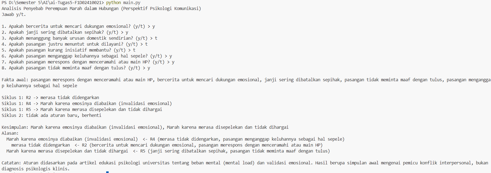

# AI Tugas 5 - Expert System (Forward Chaining)

**Nama:** Ni Wayan Eka Aprilianti  
**NIM:** F1D02410021  

## Topik & Cara Menjalankan
**Topik:** Analisis Penyebab Perempuan Marah dalam Hubungan (Perspektif Psikologi Komunikasi).  
Program ini ditulis dalam bahasa **Python** (versi 3.14). Untuk menjalankan mesin inferensi, buka terminal dan jalankan:

python main.py

## Daftar Sumber dan Tabel Aturan
**Sumber Literatur:**
- **S1:** Fakultas Psikologi UGM, "Mengenal Beban Mental (Mental Load) pada Perempuan", https://psikologi.ugm.ac.id/artikel-edukasi/, diakses 13 Nov 2026.
- **S2:** Jurnal Komunikasi Universitas Airlangga, "Validasi Emosi dalam Resolusi Konflik Interpersonal", https://journal.unair.ac.id/komunikasi, diakses 13 Nov 2026.

**Tabel Aturan (Knowledge Base):**
| Aturan | IF (Syarat) | Mode | THEN (Kesimpulan) | Sumber |
|---|---|---|---|---|
| R1 | menanggung banyak urusan domestik sendirian, pasangan kurang inisiatif membantu | AND | mengalami kelelahan mental (mental load) | S1 |
| R2 | bercerita untuk mencari dukungan emosional, pasangan merespons dengan menceramahi atau main HP | AND | merasa tidak didengarkan | S2 |
| R3 | mengalami kelelahan mental (mental load), pasangan justru menuntut untuk dilayani | AND | Marah karena beban ganda (burnout) | S1 |
| R4 | merasa tidak didengarkan, pasangan menganggap keluhannya sebagai hal sepele | AND | Marah karena emosinya diabaikan (invalidasi emosional) | S2 |
| R5 | janji sering dibatalkan sepihak, pasangan tidak meminta maaf dengan tulus | AND | Marah karena merasa disepelekan dan tidak dihargai | S2 |

## Metode
Metode yang dipilih adalah **Forward Chaining (FC)**. Alasan pemilihan metode ini adalah karena analisis konflik relasional umumnya dimulai dari pengumpulan fakta atau kejadian empiris di lapangan (kejadian A dan kejadian B terjadi), lalu dari fakta-fakta tersebut ditarik kesimpulan ke kondisi psikologis menengah (seperti kelelahan mental), dan akhirnya berujung pada akar penyebab emosi marah. Algoritma bergerak runut dari fakta menuju konklusi.

## Kasus Uji

### Kasus 1: Mendapatkan 1 Kesimpulan (Burnout)
- **Fakta diinput ("ya"):** menanggung banyak urusan domestik sendirian, pasangan justru menuntut untuk dilayani, pasangan kurang inisiatif membantu, 
- **Hasil:** Marah karena beban ganda (burnout)

### Kasus 2: Kasus Negatif (Tidak ada kesimpulan marah)
- **Fakta diinput ("ya"):** janji sering dibatalkan sepihak. *(Catatan: karena pasangan "meminta maaf dengan tulus" (syarat 2 dijawab "t"), maka R5 tidak terpenuhi).*
- **Hasil:** tidak ada (kasus negatif / tidak ada pemicu marah yang valid sesuai sistem)

### Kasus 3: Mendapatkan >1 Kesimpulan (Kompilasi Kesalahan)
- **Fakta diinput ("ya"):** bercerita untuk mencari dukungan emosional, pasangan merespons dengan menceramahi atau main HP, pasangan menganggap keluhannya sebagai hal sepele, janji sering dibatalkan sepihak, pasangan tidak meminta maaf dengan tulus.
- **Hasil:** Marah karena emosinya diabaikan (invalidasi emosional), Marah karena merasa disepelekan dan tidak dihargai

## Batas Keberlakuan
Aturan didasarkan pada artikel edukasi psikologi universitas tentang beban mental dan pentingnya validasi emosional dalam ranah sosiologi dan komunikasi interpersonal. Hasil yang diberikan oleh sistem berupa simpulan logis awal mengenai pemicu konflik sehari-hari, bukan keputusan akhir, serta tidak ditujukan sebagai alat diagnosis gangguan psikologis klinis (seperti *anger management issues*).

## Penggunaan Alat Bantu AI
AI Gemini digunakan sebagai *thought partner* untuk merumuskan fenomena sosial psikologis ke dalam bentuk IF-THEN berbentuk JSON sesuai batas parameter yang disyaratkan tugas, serta membantu menyusun logika iterasi *Forward Chaining* di Python berdasarkan perulangan `while` dan pemeriksaan sub-kondisi pada struktur set memori.